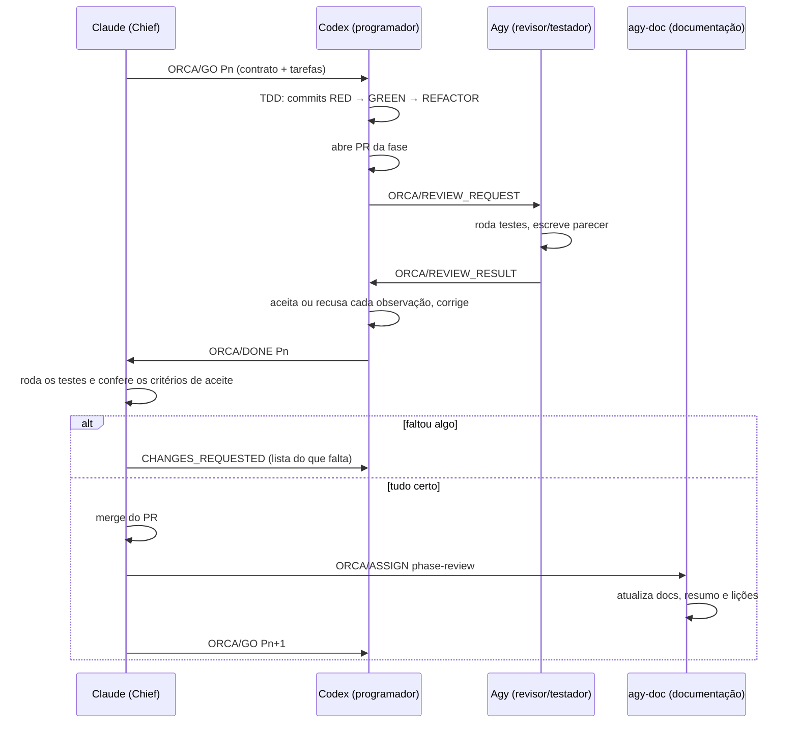

# Sistema Bancário: migração de Java para Go + React feita por agentes de IA

Trabalho de aula: pegar um sistema bancário simples, de console, escrito em Java, e refatorá-lo
para uma aplicação **cliente-servidor**:
- backend em **Go**, com TDD, BDD e DDD;
- frontend em **React**;
- banco **SQLite**;
- **2 containers Docker** ligados por uma rede.

O código foi escrito por **uma equipe de agentes de IA**, coordenada pelo protocolo **ORCA**. Este
README explica como a equipe foi organizada e como o trabalho fluiu. O sistema novo tem o seu
próprio [README](sistema-novo/README.md).

## Estrutura do repositório

```text
.
├── README.md              ← este arquivo: a metodologia da migração
├── sistema-antigo/        ← o sistema original em Java 8 (console), sem alterações
│   ├── src/               ← código de negócio
│   ├── test/              ← testes JUnit 4 (tdd/, ddd/) e Cucumber (bdd/)
│   └── docs/              ← relatórios em PDF e evidências do trabalho original
└── sistema-novo/          ← o sistema migrado
    ├── backend/           ← API em Go (arquitetura hexagonal)
    ├── frontend/          ← interface em React + Vite
    ├── docker-compose.yml ← sobe os 2 containers
    ├── docs/              ← requisitos, arquitetura, API, decisões, testes
    └── orca/              ← o "diário de bordo" da equipe de agentes (ver abaixo)
```

## Antes e depois

| | Sistema antigo | Sistema novo |
|---|---|---|
| Tipo | Aplicação de console | Cliente-servidor (navegador + API REST) |
| Linguagem | Java 8 | Go 1.25 (backend) e JavaScript/React 19 (frontend) |
| Arquitetura | Classes de negócio + menu | Hexagonal (ports & adapters) + MVC |
| Dados | Listas em memória | SQLite atrás de um adapter (troca fácil de banco) |
| Testes | JUnit 4 + Cucumber 7 | `testing` do Go + godog, Vitest + MSW, Playwright |
| Execução | `mvnw` | `docker compose up` (2 containers + rede) |
| Operações | 12 | as mesmas 12, com as mesmas regras |

Detalhes da migração:
- [Requisitos migrados e como eles interagem](sistema-novo/docs/requisitos-migrados.md)
- [Testes migrados de Java para Go](sistema-novo/docs/testes-migrados.md)
- [Testes novos](sistema-novo/docs/testes-novos.md)

## Metodologia: uma equipe de agentes de IA

### A equipe

| Quem | Papel | O que fazia |
|---|---|---|
| **Arthur** (humano) | Dono do produto | Definiu o objetivo, os papéis de cada agente e as decisões de negócio (ex.: manter `float64` como no original, bloquear transferência com conta inativa, 2 containers, evidência de TDD pelos commits). Depois deixou a equipe trabalhar sozinha até o fim. |
| **Claude** (Claude Code) | **Chief** (chefe) | Planejou as fases e tarefas, escreveu os contratos, distribuiu o trabalho e monitorou os agentes. Conferia cada entrega rodando os testes antes de aprovar o merge. |
| **Codex** | **Worker** (programador) | Escreveu o código seguindo as tarefas, fase por fase, em ciclos TDD; abria um PR por fase. |
| **Agy** | **Tester-reviewer** | Revisava o código do Codex, rodava e escrevia testes exploratórios num worktree separado e dava parecer. O Codex decidia se aceitava cada observação. |
| **agy-doc** (2ª sessão do Agy) | **Documentarian + Summarizer** | Ao fim de cada fase, relia o repositório e atualizava a documentação, o resumo do projeto e as lições aprendidas. |

### O protocolo ORCA

ORCA é um protocolo para vários agentes trabalharem no mesmo projeto sem se atropelar. O estado
do projeto fica em arquivos Markdown (a pasta [`sistema-novo/orca/`](sistema-novo/orca/)), não na
memória dos agentes. Assim qualquer agente, inclusive um que acabou de ser aberto, sabe o que
fazer.

| Artefato | Para que serve | Onde |
|---|---|---|
| **Papéis** | O que cada função pode e não pode fazer | [`orca/roles/`](sistema-novo/orca/roles/) |
| **Contratos** | Delegação formal: quem, qual papel, quais tarefas, quais skills ler antes, como reportar, critério de pronto | [`orca/contracts/`](sistema-novo/orca/contracts/) |
| **Fases e tarefas** | Cada fase tem objetivo, critérios de entrada e saída; cada tarefa tem critérios de aceite | [`orca/phases/`](sistema-novo/orca/phases/) |
| **Diários** | Registro de cada agente: o que fez, comandos, problemas, decisões | `orca/phases/*/diaries/` |
| **Revisões** | Os pareceres do revisor, rodada por rodada | `orca/phases/*/reviews/` |
| **Resumo e lições** | Estado consolidado e o que aprendemos | [`SUMMARY.md`](sistema-novo/orca/SUMMARY.md), [`LESSONS_LEARNED.md`](sistema-novo/orca/LESSONS_LEARNED.md) |
| **Decisões (ADRs)** | Cada decisão de arquitetura ou negócio, com o motivo | [`docs/decisoes.md`](sistema-novo/docs/decisoes.md) (20 ADRs) |

### Como os agentes conversavam

Cada agente rodava no seu próprio terminal dentro do aplicativo **Orca**. As mensagens seguiam
tipos fixos do protocolo:
- `ORCA/ASSIGN` e `ORCA/GO`: entregar trabalho;
- `ORCA/ACCEPT`: aceitar o trabalho recebido;
- `ORCA/STATUS`: informar andamento;
- `ORCA/REVIEW_REQUEST` e `ORCA/REVIEW_RESULT`: pedir e devolver revisão;
- `ORCA/DONE`: avisar que a fase terminou.

Os agentes mandavam mensagens para o Chief por um canal de orquestração (`orca orchestration send`).
O Chief escrevia direto no terminal de cada agente (`orca terminal send`).

O ciclo de cada fase:



### Execução autônoma e monitoramento

Depois de dar os papéis, o Arthur pediu que a equipe fosse até a última fase sem pedir nada a ele.
Para isso o Chief:
- **Checava os agentes a cada 10 minutos**, seguindo um roteiro
  ([`orca/state/chief-loop.md`](sistema-novo/orca/state/chief-loop.md)):
  - processava a caixa de mensagens;
  - lia a tela de cada terminal;
  - destravava quem estivesse parado, esperando aprovação, sem limite de uso ou sem conseguir se
    comunicar.
- **Mantinha um auto-continue para o Codex**
  ([`codex-autonudge.sh`](sistema-novo/orca/state/codex-autonudge.sh)). O Codex costumava encerrar
  a vez no meio da fase. O script percebia que ele estava parado sem PR aberto e mandava continuar.

### Conhecimento compartilhado: Graphify

Os agentes usavam o **Graphify**, um grafo de conhecimento do projeto com código, docs e arquivos
ORCA. Com ele respondiam perguntas como "o que depende do repositório de contas?" sem reler tudo.
Todos usavam **o mesmo grafo**. Ele não está neste repositório porque é gerado automaticamente;
a configuração está em [`orca/GRAPHIFY.md`](sistema-novo/orca/GRAPHIFY.md).

### Engenharia aplicada pelo programador

- **TDD**: para cada regra, um commit com o teste falhando (RED), outro com o código mínimo
  (GREEN) e, se preciso, um de limpeza (REFACTOR). A prova é o histórico git.
- **BDD**: os 15 cenários Gherkin do original, em português, rodando com godog, mais 3 cenários novos.
- **DDD**: linguagem do domínio em português (`Cliente`, `ContaCorrente`, `Transferir`), situação
  como tipo próprio, erros do domínio com nome.
- **Arquitetura hexagonal**: o domínio não conhece banco nem HTTP. O SQLite e o adaptador em
  memória implementam a mesma porta e passam pela mesma suíte de testes.

## As fases

| Fase | Objetivo | PR |
|---|---|---|
| P001 | Planejamento: análise do sistema antigo, requisitos, arquitetura, fases e contratos | — (só documentos) |
| P002 | Domínio e casos de uso em Go (TDD/DDD) | #1 |
| P003 | Persistência SQLite com adapter e Unit of Work | #2 |
| P004 | API REST e BDD com godog | #3 |
| P005 | Frontend React + testes de frontend | #4 |
| P006 | Docker: 2 containers, rede e E2E com Playwright | #5 |
| P007 | Revisão de qualidade e segurança, documentação de entrega | #6, #7 |
| P008 | Redesign do frontend (pesquisa de design + implementação) | #8, #9 |

Todo o trabalho aconteceu entre 22 e 24 de outubro de 2026: 9 PRs, 33 tarefas, 22 pareceres de
revisão e 34 diários.

## O que funcionou e o que não funcionou

O registro completo está em [`LESSONS_LEARNED.md`](sistema-novo/orca/LESSONS_LEARNED.md)
(14 lições). As principais:

- **A revisão por outro agente não bastou.** Mais de uma vez o revisor aprovou PRs que não
  cumpriam todos os critérios de aceite. Faltavam testes de rollback no SQLite, havia poucos testes
  de frontend e o CSS deixava os botões principais sem cor. O que segurou a qualidade foi o Chief
  rodar os testes e conferir os critérios antes de cada merge, pedindo correções quando faltava
  algo (L-004, L-007, L-013).
- **Agentes param sem avisar.** O programador encerrava a vez no meio da fase, sem PR e sem
  reportar bloqueio. O monitor de 10 minutos e o auto-continue resolveram (L-005).
- **O TDD pelos commits exige disciplina.** Na P004 alguns commits de código vieram antes do teste
  RED; o Chief registrou a ressalva no aceite da fase (L-006).
- **Cada agente precisa do seu espaço.** No começo o revisor trocou de branch dentro da pasta do
  programador. Daí em diante cada um passou a trabalhar no seu próprio worktree do git.
- **Escrever o estado em arquivos funciona.** Contratos, tarefas e diários permitiram retomar o
  trabalho depois de travamentos, limites de uso e trocas de modelo sem perder contexto.

## Limitações conhecidas

- 4 dos 40 testes JUnit do original não têm equivalente em Go
  ([detalhes](sistema-novo/docs/testes-migrados.md#4-o-que-não-foi-migrado)).
- A revisão final de interface encontrou problemas de acabamento ainda não corrigidos:
  - mensagens de erro do backend aparecem sem acento;
  - os formulários de cadastro não são modais;
  - a tabela de clientes rola para o lado em telas de 320 px;
  - o tema não segue a preferência do sistema.
- Os arquivos dentro de [`orca/`](sistema-novo/orca/) são um retrato fiel do processo. Por isso
  citam caminhos da máquina original e a estrutura de pastas anterior a esta reorganização
  (ex.: `sistemabancariorefatorado/backend` em vez de `sistema-novo/backend`).

## Como rodar

```bash
cd sistema-novo
docker compose up --build        # abre em http://localhost:3000
```

Testes:

```bash
cd sistema-novo/backend && go test ./...           # unidade, contrato, HTTP e BDD
cd sistema-novo/frontend && npm ci && npm test     # Vitest
```

Sistema antigo (precisa de Java 8+):

```bash
cd sistema-antigo && ./mvnw test
```
