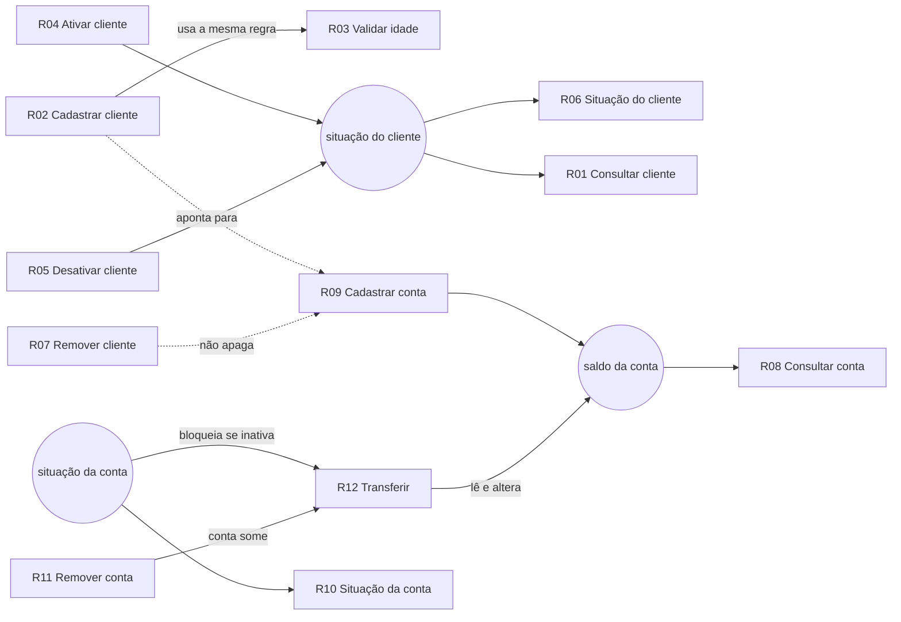

# Requisitos migrados

Este documento lista os requisitos do sistema original (Java, console) e diz onde cada um ficou no
sistema novo (backend em Go + frontend em React). Depois explica como os requisitos dependem uns dos
outros.

- Regras detalhadas: [requisitos.md](requisitos.md)
- Rotas e erros: [api.md](api.md)
- Decisões: [decisoes.md](decisoes.md)

## 1. Os 12 requisitos funcionais

Todos os 12 foram migrados com o mesmo comportamento do original. Na tabela, "Domínio" é a regra
pura, "Caso de uso" é a orquestração e "API" é a rota HTTP que o frontend chama.

| # | Operação | Domínio (Go) | Caso de uso (Go) | API | Tela |
|---|---|---|---|---|---|
| R01 | Consultar cliente | `domain/cliente/cliente.go` | `cliente.Servico.Consultar` | `GET /api/clientes/{id}` | Clientes → Consultar cliente |
| R02 | Cadastrar cliente | `cliente.Novo` | `cliente.Servico.Cadastrar` | `POST /api/clientes` | Clientes → Novo cliente |
| R03 | Validar idade | `cliente.IdadePermitida` (18 a 65, inclusive) | `cliente.Servico.IdadePermitida` | `GET /api/clientes/validacao-idade?idade=N` | Clientes → Validar idade |
| R04 | Ativar cliente | `Cliente.Ativar` | `cliente.Servico.Ativar` | `POST /api/clientes/{id}/ativar` | Clientes → Ativar |
| R05 | Desativar cliente | `Cliente.Desativar` | `cliente.Servico.Desativar` | `POST /api/clientes/{id}/desativar` | Clientes → Desativar |
| R06 | Situação do cliente | tipo `Situacao` (`Ativo`/`Inativo`) | `cliente.Servico.Situacao` | `GET /api/clientes/{id}/situacao` | Clientes → Ver situação |
| R07 | Remover cliente | — | `cliente.Servico.Remover` | `DELETE /api/clientes/{id}` | Clientes → Remover (com confirmação) |
| R08 | Consultar conta | `domain/conta/conta.go` | `conta.Servico.Consultar` | `GET /api/contas/{id}` | Contas → Buscar conta por ID |
| R09 | Cadastrar conta | `conta.Nova` (saldo finito) | `conta.Servico.Cadastrar` | `POST /api/contas` | Contas → Nova conta |
| R10 | Situação da conta | tipo `Situacao` (`Ativa`/`Inativa`) | `conta.Servico.Situacao` | `GET /api/contas/{id}/situacao` | Contas → Situação |
| R11 | Remover conta | — | `conta.Servico.Remover` | `DELETE /api/contas/{id}` | Contas → Remover (com confirmação) |
| R12 | Transferir | `conta.Transferir` (`transferencia.go`) | `conta.Servico.Transferir` (com Unit of Work) | `POST /api/transferencias` | Transferir (formulário → revisão → recibo) |

### O que mudou em relação ao original

O comportamento foi mantido. As diferenças abaixo foram decididas e registradas:

| Mudança | Motivo | Registro |
|---|---|---|
| A transferência recusa conta de origem ou destino **inativa** | Decisão do usuário: o original permitia | [ADR-011](decisoes.md#adr-011) |
| A transferência recusa origem igual ao destino | O original não tratava o caso | [ADR-018](decisoes.md#adr-018) |
| Erros viram **erro tipado** com código e status HTTP (ex.: `saldo_insuficiente` → 422) | O original devolvia `false` | [api.md](api.md) |
| Ativar e desativar **conta** aparecem na API e na tela | Existia no domínio, não no menu; é necessário para testar R10 | Q02 em [requisitos.md](requisitos.md) |
| Listar clientes e contas aparece na API e na tela | Existia só no repositório | Q03 em [requisitos.md](requisitos.md) |

Ficaram de fora, como no original: validar se `idContaCorrente` existe no cadastro do cliente (Q01),
alterar nome ou e-mail do cliente (Q04) e login de usuários (Q05).

### Dados iniciais

Iguais ao original: contas 1 e 2 com R$ 100,00, ativas; clientes Maria Silva (31, conta 1) e
Felipe Augusto (34, conta 2), ativos. A carga é idempotente: rodar duas vezes não duplica nada
(`internal/seed`).

## 2. Requisitos não funcionais

| ID | Requisito | Como foi atendido |
|---|---|---|
| RNF01 | Go com arquitetura hexagonal + MVC | `domain` → `application` (+ `ports`) ← `adapters` (`http`, `memory`, `sqlite`) |
| RNF02 | Arquivos pequenos | Um conceito por arquivo; o maior arquivo de produção do backend é o roteador |
| RNF03 | SQLite atrás de um adapter (DAO) | Portas `ClienteRepository` e `ContaRepository`; o mesmo teste de contrato roda no adapter de memória e no SQLite |
| RNF04 | TDD, BDD e DDD | Ver [testes-migrados.md](testes-migrados.md) e [testes-novos.md](testes-novos.md) |
| RNF05 | Testes de frontend | Vitest + React Testing Library + MSW, mais Playwright de ponta a ponta |
| RNF06 | 2 containers numa rede Docker | Serviços `backend` e `frontend` na rede `banco-net`; só a porta 3000 é publicada ([infra-docker.md](infra-docker.md)) |
| RNF07 | Evidência de TDD pelo git | Commits `test(...)`/`feat(...)`/`refactor(...)` no histórico |
| RNF08 | Rodar com um comando | `docker compose up --build` |

## 3. Como os requisitos interagem

Os requisitos não são independentes. As 6 relações abaixo mostram onde uma operação depende do
resultado de outra, e o que o sistema faz para manter as regras consistentes.

### 3.1 R02 Cadastrar cliente ↔ R03 Validar idade

O cadastro e a consulta isolada de idade usam **a mesma função** do domínio,
`cliente.IdadePermitida` (18 ≤ idade ≤ 65). `cliente.Novo` chama essa regra ao criar o cliente, e a
rota `validacao-idade` chama a mesma função. Assim a tela "Validar idade" nunca diz "permitida" para
uma idade que o cadastro recusaria.

Ordem dentro do cadastro (`cliente.Servico.Cadastrar`):
1. procura o id no repositório; se já existe → `id_duplicado` (409);
2. cria o cliente pelo domínio, que valida a idade → `idade_nao_permitida` (422);
3. grava.

Por isso, um id repetido com idade inválida responde "id duplicado", não "idade inválida". A mesma
regra vale para alterar a idade depois (`DefinirIdade`): fora da faixa dá erro e a idade antiga é
mantida.

### 3.2 R04 Ativar e R05 Desativar → R06 Situação e R01 Consultar cliente

Ativar e desativar só mudam o campo `situacao` do cliente. R06 e R01 leem esse mesmo campo:
- depois de R05, R06 responde `Inativo` e R01 mostra o cliente como inativo;
- ativar ou desativar duas vezes seguidas dá sucesso nas duas (idempotente), como no original.

As 4 operações tratam um id inexistente igual: erro `cliente_nao_encontrado` (404). Isso garante que
**inexistente é diferente de inativo**: R06 nunca responde `Inativo` para um cliente que não existe.

### 3.3 R02 Cadastrar cliente, R09 Cadastrar conta e R07 Remover cliente

O cliente guarda o número da conta (`idContaCorrente`), mas cliente e conta são entidades separadas,
cada uma no seu repositório:
- **R02 não exige que a conta exista** (paridade com o original, Q01);
- **R07 remove só o cliente.** A conta continua existindo, com o mesmo saldo, e continua podendo
  ser consultada (R08) e usada em transferências (R12);
- remover a conta (R11) também não altera o cliente.

### 3.4 R09 Cadastrar conta → R12 Transferir → R08 Consultar conta

O saldo nasce em R09, é alterado só por R12 e é exibido por R08:
- R09 exige saldo **finito** (recusa `NaN` e infinito);
- R12 só credita se o saldo do destino continuar finito (`credito_nao_finito`), então nenhuma
  transferência quebra a regra de R09;
- a transferência roda dentro de uma **Unit of Work**: débito e crédito são gravados juntos ou nenhum
  é gravado (no SQLite, numa transação). Se gravar o destino falhar, a origem também volta ao saldo
  anterior. R08 nunca mostra uma transferência pela metade.

### 3.5 R10 Situação da conta (e ativar/desativar conta) → R12 Transferir

A situação da conta, que R10 informa, decide se R12 pode acontecer:
- origem inativa → `conta_origem_inativa` (422);
- destino inativo → `conta_destino_inativa` (422);
- nos dois casos nenhum saldo muda.

Esta regra é nova ([ADR-011](decisoes.md#adr-011)). No original, desativar uma conta não impedia
transferências.

### 3.6 R11 Remover conta → R12 Transferir e R08 Consultar conta

Depois que uma conta é removida:
- R08 responde `conta_nao_encontrada` (404);
- R12 responde `conta_origem_nao_encontrada` ou `conta_destino_nao_encontrada` (404).

Isto é diferente de uma conta inativa, que existe mas está bloqueada (422).

### 3.7 Ordem das verificações da transferência (R12)

R12 junta as regras de R08, R09, R10 e R11. As verificações seguem esta ordem, e a primeira que
falhar define o erro:

1. origem igual ao destino → `mesma_conta`
2. origem existe (R11/R08) → `conta_origem_nao_encontrada`
3. destino existe (R11/R08) → `conta_destino_nao_encontrada`
4. valor maior que zero → `valor_invalido`
5. origem ativa (R10) → `conta_origem_inativa`
6. destino ativo (R10) → `conta_destino_inativa`
7. saldo suficiente → `saldo_insuficiente`
8. saldo do destino continua finito (R09) → `credito_nao_finito`

Só depois disso o débito e o crédito são gravados, juntos.
